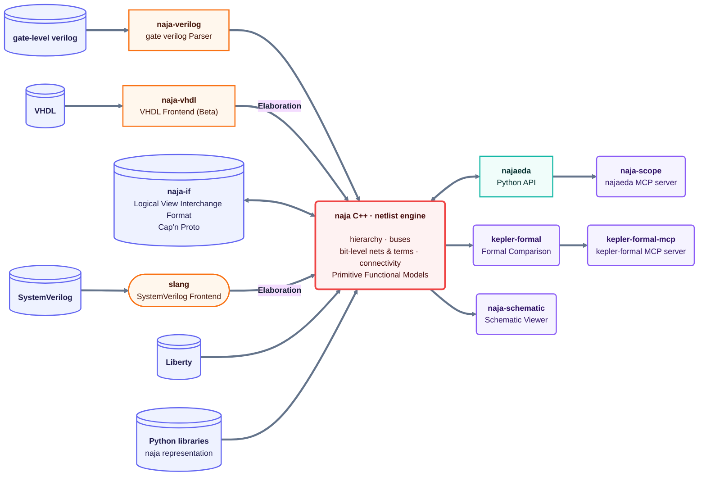

<div align="center">
<h1>Naja</h1>
</div>

[](https://pypi.org/project/najaeda)
[](
https://colab.research.google.com/github/najaeda/naja/blob/main/tutorials/notebooks/01_getting_started.ipynb)
[](https://matrix.to/#/#naja:fossi-chat.org)


[](https://codecov.io/gh/najaeda/naja)
[](https://opensource.org/licenses/Apache-2.0)
[](https://api.reuse.software/info/github.com/najaeda/naja)

## What is Naja?

Naja is an open source EDA framework for loading, elaborating, analyzing, optimizing, and transforming hardware designs from SystemVerilog and VHDL RTL through structural netlists. It is usable from Python or C++.

- **Gate-level Verilog frontend** — load structural netlists and their connectivity
- **SystemVerilog RTL frontend** — elaborate supported Verilog and SystemVerilog RTL into a browsable design model through slang
- **VHDL frontend (Beta)** — parse and elaborate supported VHDL RTL into the same design model
- **Netlist analysis** — hierarchy, connectivity, equipotentials
- **Logic optimization** — dead logic elimination, constant propagation
- **ECO transformations** — direct netlist editing
- **Serialization** — SNL interchange format (Cap'n Proto) and Verilog output

In the APIs and CLI, `load_gate_level_verilog`, `NLDB.loadGateLevelVerilog`, and `-f gate-level-verilog` mean
**gate-level (structural) Verilog**, not general behavioral RTL. For Verilog or
SystemVerilog RTL, including `.v` sources, use `load_system_verilog`,
`NLDB.loadSystemVerilog`, or `-f systemverilog` within the slang frontend's
supported RTL subset. Verilog export writes structural netlists. The former Python names
(`load_verilog`, `VerilogConfig`, `dump_verilog`, `VerilogDumpConfig`, and raw
`loadVerilog`/`dumpVerilog`) remain compatibility aliases and warn that they
will be deprecated soon. The CLI also keeps `-f verilog` and `-t verilog` as
compatibility aliases with the same migration warning; prefer `gate-level-verilog`.

### Architecture

The diagram below shows how formats, frontends, APIs, and companion tools
integrate around Naja's C++ netlist engine:

- **Design inputs** — SystemVerilog is parsed and elaborated through
  [`slang`](https://github.com/MikePopoloski/slang); VHDL is parsed and elaborated
  through the **naja-vhdl** frontend (Beta); gate-level Verilog can be
  loaded and emitted; and Liberty plus the
  [Python primitive libraries](./src/najaeda/najaeda/primitives/) provide cell
  and primitive models.
- **Core and interchange** — Naja represents hierarchy, buses, bit-level nets
  and terms, connectivity, and primitive functional models. The
  [`naja-if`](https://github.com/keplertech/naja-if) Cap'n Proto format provides a
  logical-view interchange path.
- **APIs and tools** — [`najaeda`](https://pypi.org/project/najaeda/) exposes
  the engine through Python. Companion projects build on Naja directly or
  through that API: [`kepler-formal`](https://github.com/keplertech/kepler-formal),
  [`naja-schematic`](https://github.com/keplertech/naja-schematic), and
  [`naja-scope`](https://github.com/keplertech/naja-scope).



## Get Started

The best entry point is the [`najaeda`](https://pypi.org/project/najaeda/) Python package:

```bash
pip install najaeda
```

Requires Python 3.10 or later. Pre-built wheels are published for:

- Linux x86_64 and AArch64 (`manylinux_2_28`; glibc 2.28 or later)
- macOS Apple Silicon (arm64), macOS 11 or later
- Windows x86_64

Full documentation: [najaeda.readthedocs.io](https://najaeda.readthedocs.io/en/latest/)

For AI-assisted design exploration, [`naja-scope`](https://github.com/najaeda/naja-scope)
is a najaeda-based MCP server that gives MCP-compatible assistants a precise,
structured view of elaborated SystemVerilog or VHDL designs. Instead of pasting large
RTL files into chat, agents can ask targeted questions — what drives a signal,
what is inside a module, where a net comes from — and get small, exact answers
with file-and-line references.

### Tutorials

Six hands-on notebooks — open any of them in Colab with no local install needed:

| # | Topic | Colab |
| --- | --- | --- |
| 1 | Getting started — load Verilog, navigate hierarchy, visualize | [](https://colab.research.google.com/github/najaeda/naja/blob/main/tutorials/notebooks/01_getting_started.ipynb) |
| 2 | Liberty primitives — load a synthesised design with standard cells | [](https://colab.research.google.com/github/najaeda/naja/blob/main/tutorials/notebooks/02_liberty_primitives_design.ipynb) |
| 3 | Editing a netlist — rename, disconnect, reconnect, delete | [](https://colab.research.google.com/github/najaeda/naja/blob/main/tutorials/notebooks/03_editing_a_netlist.ipynb) |
| 4 | SystemVerilog elaboration — load and browse an elaborated SV design | [](https://colab.research.google.com/github/najaeda/naja/blob/main/tutorials/notebooks/04_systemverilog_elaborated_netlist.ipynb) |
| 5 | ibex RISC-V core — explore a real-world SV core, collect stats | [](https://colab.research.google.com/github/najaeda/naja/blob/main/tutorials/notebooks/05_ibex_riscv_core.ipynb) |
| 6 | Fanout analysis — compute fanout for every net, trace drivers, export to pandas | [](https://colab.research.google.com/github/najaeda/naja/blob/main/tutorials/notebooks/06_fanout_analysis.ipynb) |

## `naja_edit` — Netlist CLI

`naja_edit` is a command-line tool for optimizing and translating netlists.

:tv: Presented at [ORConf 2024](https://www.youtube.com/watch?v=JpwZGCuWekU).

```bash
# Translate gate-level Verilog → SNL
naja_edit -f gate-level-verilog -t snl -i input.v -o output.snl

# Elaborate Verilog/SystemVerilog RTL with explicit top; export a gate-level netlist
naja_edit -f systemverilog -t gate-level-verilog -i input.sv -o output.v --sv_top top

# Dead logic elimination
naja_edit -f snl -t snl -i input.snl -o output.snl -a dle

# Chain optimizations with Python scripts
naja_edit -f snl -t snl -i input.snl -o output.snl -a dle -e pre.py -z post.py
```

Available optimizations (`-a`): `all` (DLE + constant propagation + primitives), `dle`.

Python script examples: [src/apps/naja_edit/examples](https://github.com/najaeda/naja/blob/main/src/apps/naja_edit/examples)  
Regression suite: [naja-regress](https://github.com/najaeda/naja-regress)

## Building from Source

For the same Naja revision, platform and requested features, CMake and Bazel must
deliver equivalent Naja and najaeda products: the same APIs, supported features,
defaults, diagnostics, netlist behavior, serialization and package contents.
Any difference caused by the build system is a bug. Matching dependency revisions
alone does not establish this equivalence; common behavior and package checks
must validate it. Independent BCR publication timing does not relax this rule
for a published Naja release.

Naja has three delivery paths: CMake builds from sources, Bazel builds from
sources, and Bazel Central Registry (BCR) distribution. Both source build systems
serve users and package builds, including najaeda; shared source dependencies
must use the same revisions. BCR publication follows its own schedule and may
lag source builds without blocking source changes or package builds.

CMake currently provides the established install and packaging workflow.
Bazel provides build/test targets. Its default configuration uses the same
naja-if and naja-verilog checkouts as CMake; `--config=registered` selects the
published dependencies instead. Slang temporarily remains registry-backed with exact
source revision checks until its native upstream Bazel support permits direct
checkout selection. See [the repository build policy](./CLAUDE.md#build-and-delivery-policy-cmake-bazel-and-bcr).

### CMake

#### Dependencies

**Ubuntu:**

```bash
sudo apt-get update
sudo apt-get install build-essential cmake git libboost-dev python3-dev \
  capnproto libcapnp-dev libtbb-dev pkg-config bison flex
```

**macOS (Homebrew):**

```bash
brew install cmake capnp tbb bison flex boost
export PATH="/opt/homebrew/opt/flex/bin:/opt/homebrew/opt/bison/bin:$PATH"
```

**Nix:**

```bash
nix-shell -p cmake gnumake boost python3 capnproto bison flex pkg-config tbb_2021_8
```

#### Build, test, and install

```bash
git clone --recurse-submodules https://github.com/najaeda/naja.git
cd naja
export NAJA_INSTALL="$PWD/install"
cmake -S . -B build \
  -DCMAKE_BUILD_TYPE=Release \
  -DCMAKE_INSTALL_PREFIX="$NAJA_INSTALL"
cmake --build build --parallel
ctest --test-dir build --output-on-failure
cmake --install build

# Add the installed Python package to your environment.
export PYTHONPATH="${PYTHONPATH:+$PYTHONPATH:}$NAJA_INSTALL/lib/python"
```

### Bazel source build

The Bazel build covers the repository's build and test targets on Ubuntu and
macOS. The version is pinned in [`.bazelversion`](./.bazelversion); using
[Bazelisk](https://github.com/bazelbuild/bazelisk) as the `bazel` command
automatically selects it.

Initialize naja-if and naja-verilog before a default Bazel build. Schema and
parser sources use the same checkouts as CMake, including unpublished changes.
Other dependencies currently resolve through the configured registries; the
source dependency check verifies shared source revisions.

**Ubuntu:**

```bash
sudo apt-get update
sudo apt-get install build-essential cmake libboost-dev libfl-dev libtbb-dev \
  bison flex m4 pkg-config python3-dev git
```

**macOS (Homebrew):**

Install the Xcode Command Line Tools, then:

```bash
brew install cmake capnp tbb bison flex boost fmt tomlplusplus pkg-config
export PATH="$(brew --prefix flex)/bin:$(brew --prefix bison)/bin:$PATH"
```

Build and test from the repository root:

```bash
git clone https://github.com/najaeda/naja.git
cd naja
git submodule update --init thirdparty/naja-if thirdparty/naja-verilog
bazel build //... --jobs=auto
bazel test //... --test_output=errors --jobs=auto
```

These are the same smoke commands used by
[`ubuntu-bazel.yml`](./.github/workflows/ubuntu-bazel.yml) and
[`macos-bazel.yml`](./.github/workflows/macos-bazel.yml). There is no Bazel
install target; use the CMake workflow above when you need an installed
library, Python package, or packaged artifact.

Check source selection and the remaining registry-backed source revisions:

```bash
python3 ci/check_submodule_bazel_sync.py
```

### Registered Bazel distribution

Validate the registry dependency set independently, without local dependency checkouts initialized:

```bash
bazel build --config=registered //...
bazel test --config=registered //... --test_output=errors
```

This clears the local dependency overrides and uses the immutable versions in
[`MODULE.bazel`](./MODULE.bazel). It does not switch Naja's own source revision.
Registered dependencies may lag source builds; an older schema can therefore
fail to compile newer Naja code. Update and validate registry versions when
preparing BCR distribution, independently of source/package changes. The manual
[`bazel-registered.yml`](./.github/workflows/bazel-registered.yml) workflow performs
these checks separately from source CI. BCR's consumer presubmits also validate
Naja as an external dependency, where this repository's .bazelrc is not inherited.

## C++ API

Naja exposes two complementary APIs:

- **SNL** (Structured Netlist) — full read/write netlist representation
- **DNL** (Dissolved Netlist) — fast, read-only flattened view for parallel analysis

Extended documentation: [naja.readthedocs.io](https://naja.readthedocs.io/en/latest/)  
C++ snippet: [NLUniverseSnippet.cpp](https://github.com/najaeda/naja/blob/main/src/app_snippet/src/NLUniverseSnippet.cpp)  
App template (copy to start a new tool): [src/app_snippet](https://github.com/najaeda/naja/blob/main/src/app_snippet)

## Community

- Chat: [Matrix #naja:fossi-chat.org](https://matrix.to/#/#naja:fossi-chat.org)
- Bugs / features: [GitHub Issues](https://github.com/najaeda/naja/issues)
- Contact: [contact@keplertech.io](mailto:contact@keplertech.io)

:star: If you find Naja useful, starring the repo helps spread the word.

## Acknowledgement

[](https://nlnet.nl/project/Naja)
[](https://nlnet.nl/project/Naja)

Supported by [NLNet](https://nlnet.nl/project/Naja) through the [NGI0 Entrust](https://nlnet.nl/entrust) Fund.
